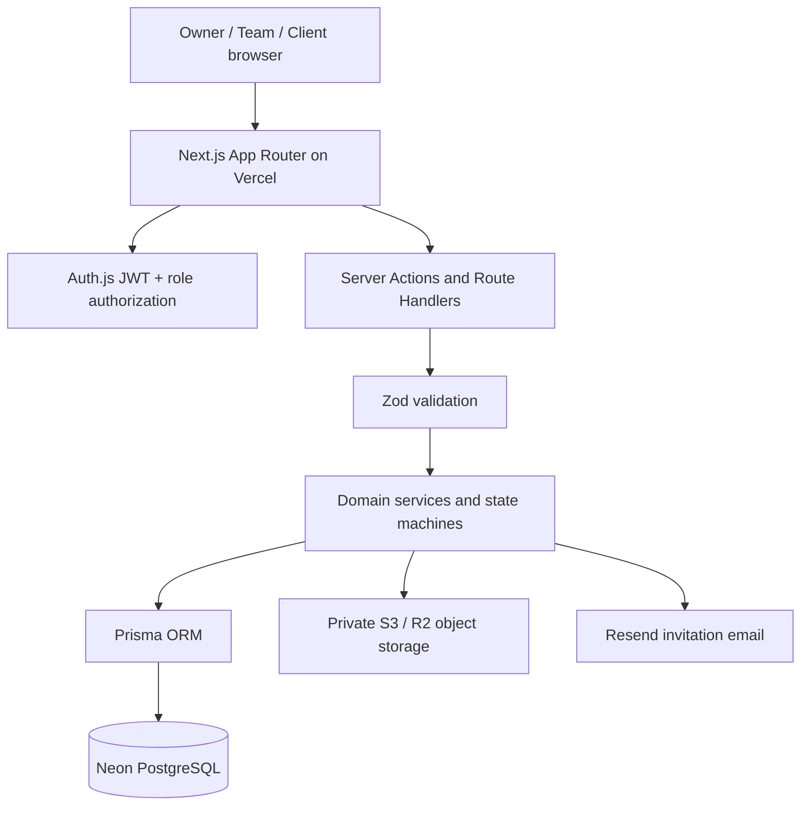
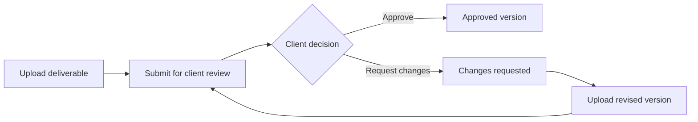

# ClientFlow

ClientFlow is a multi-tenant client and project management SaaS for freelancers and small agencies. Teams manage clients, projects, milestones, tasks, and versioned deliverables. Clients receive a restricted portal to track shared progress and approve or request changes to submitted work.

## Stack

- Next.js App Router, React Server Components, Server Actions, Route Handlers
- TypeScript strict mode
- PostgreSQL and Prisma 7
- Auth.js Credentials with JWT sessions
- Argon2id password hashing
- Tailwind CSS
- Zod validation
- Vitest and Playwright
- Vercel deployment target with Neon PostgreSQL
- Local private file storage in development; S3-compatible private object storage in production

## Demo access

The seed script creates an OWNER account and a linked CLIENT portal account. In a seeded demo environment, use:

| Role | Email | Password |
| --- | --- | --- |
| Owner | `owner@clientflow.local` | `ClientFlowDemo!2026` |
| Client | `client@clientflow.local` | `ClientFlowDemo!2026` |

**Public demo warning:** this is shared demo data, not a private workspace. Other visitors can create, edit, or delete demo records. The demo database may be reset without notice. Never upload confidential files or reuse these credentials elsewhere. Set `SEED_DEMO_PASSWORD` to override the seed password.

## One-command local demo

Start PostgreSQL and the Next.js app, apply migrations, and seed the Owner/Client demo accounts:

```bash
docker compose up --build
```

Then open [http://localhost:3000](http://localhost:3000). The Compose setup uses local file storage and a disposable PostgreSQL volume; it is for local development/demo only, not production. Use `docker compose down -v` to remove the local database and uploaded demo files.

## Architecture



## Review lifecycle



## Local setup

Requirements: Node.js 22+, npm, and Docker Desktop / Docker Engine.

1. Start the local PostgreSQL database:

   ```bash
   docker compose up -d postgres
   ```

2. Install dependencies:

   ```bash
   npm ci
   ```

3. Create `.env`:

   **PowerShell**
   ```powershell
   Copy-Item .env.example .env
   ```

   **macOS / Linux**
   ```bash
   cp .env.example .env
   ```

4. Configure `DATABASE_URL` and a random `AUTH_SECRET` (at least 32 characters).
5. Generate the Prisma Client:

   ```bash
   npm run db:generate
   ```

6. Apply the Prisma migration(s):

   ```bash
   npm run db:migrate
   ```

7. Seed the local database with demo workspaces, roles, clients, and projects:

   ```bash
   npm run db:seed
   ```

8. Start the app:

   ```bash
   npm run dev
   ```

Open http://localhost:3000, create an account, and create a workspace.

## Main flows currently implemented

- Account registration and Credentials sign-in with Argon2id verification.
- Workspace creation and OWNER membership.
- Workspace-scoped client and project creation.
- Project milestones and task creation/status changes.
- Client portal account linking to an existing account with a matching email.
- Restricted client portal project overview; only tasks marked `visibleToClient` are returned.
- Deliverable drafts, submission, client approval or change requests, and version creation after requested changes.
- Optimistic revision checks to prevent duplicate deliverable decisions.
- Transactional Activity records for supported mutations.
- Workspace invitations with hashed, expiring tokens and acceptance.
- Database-backed login and invitation rate limits.
- Private file upload/download through local storage in development and S3-compatible storage in production.

## Production object storage

Configure these environment variables in Vercel (or the deployment environment):

- `S3_BUCKET`
- `S3_REGION`
- `S3_ACCESS_KEY_ID`
- `S3_SECRET_ACCESS_KEY`
- Optional `S3_ENDPOINT` for S3-compatible services such as Cloudflare R2.

The production storage adapter uses server-side credentials and does not expose object URLs publicly. Downloads are streamed through an authenticated Route Handler.

Uploads currently allow PDF, PNG, JPEG, WebP, DOCX, and XLSX files up to 4 MB. File names are sanitized for display; object keys are generated server-side. DOCX/XLSX ZIP contents are not inspected for decompressed-size, entry-count, or compression-ratio limits, and malware scanning is not implemented; treat archive inspection as out of scope for this demo.

## Quality checks

```bash
npm run lint
npm run typecheck
npm test
npm run test:e2e
npm run build
```

GitHub Actions runs three independent jobs: quality/build, PostgreSQL integration tests, and Playwright E2E. The quality job also checks Prettier formatting with `npm run format:check`. E2E includes axe-core WCAG 2.1 A/AA checks and uploads a Lighthouse report covering performance, accessibility, best practices, and SEO.

## Design decisions

- **Explicit state machine:** deliverable review transitions are constrained to valid states, and reviewed versions remain immutable. This prevents clients and team members from applying conflicting or invalid decisions.
- **PostgreSQL rate limiting:** fixed-window counters are updated atomically in the shared database, so multiple Vercel instances use the same limits instead of independent in-memory counters.
- **Optimistic revision checks:** a review decision includes the expected revision in its conditional update. Only one concurrent decision can update that revision; a stale request is rejected rather than overwriting a newer state.
- **Tenant-scoped relational constraints:** workspace identifiers are included in relevant foreign keys and queries to reduce the risk of cross-workspace references.

## Database commands

- `npm run db:generate` — generate Prisma Client.
- `npm run db:seed` — seed local demo users, workspaces, clients, and projects.
- `docker compose down -v` — remove the local database volume (destructive; deletes local data).
- `npm run db:migrate` — create/apply a development migration.
- `npm run db:deploy` — apply committed migrations in deployment.
- `npm run db:studio` — open Prisma Studio.

Commit migration files together with schema changes. Never commit `.env`, database credentials, or production secrets.

## Security and architecture rules

- Workspace-owned reads and writes are scoped by `workspaceId`.
- Workspace membership, role checks, and client project access are enforced server-side.
- Client portal queries exclude internal tasks and unrelated client projects.
- Server inputs are validated with Zod and persisted under database constraints.
- Deliverable state transitions are explicit; decided versions are not edited in place.
- Revision checks use conditional updates inside transactions.
- Supported mutations create Activity records in the same transaction.
- Services live in `src/server/services`; shared schemas live in `src/lib/validations`.
- Private file downloads re-check workspace or client project access on every request.

## Deployment

1. Provision Neon PostgreSQL and set `DATABASE_URL`.
2. Set `AUTH_SECRET`, `AUTH_URL`, and the S3-compatible storage variables.
3. Configure the Vercel project for this repository and branch.
4. Run `npm run db:deploy` as a release/deployment step before serving the new application version.
5. Deploy with `npm run build`.

Do not consider a deployment production-ready until a real Neon database, production S3 bucket, environment variables, and the complete migration set have been configured and verified.


See [docs/DATABASE.md](docs/DATABASE.md) for the Mermaid ER diagram and database constraint rationale.


## Production setup

See [Production service setup](docs/PRODUCTION_SETUP.md) for PostgreSQL migration preflight, private S3-compatible storage, Resend invitation email, and post-deployment verification.
