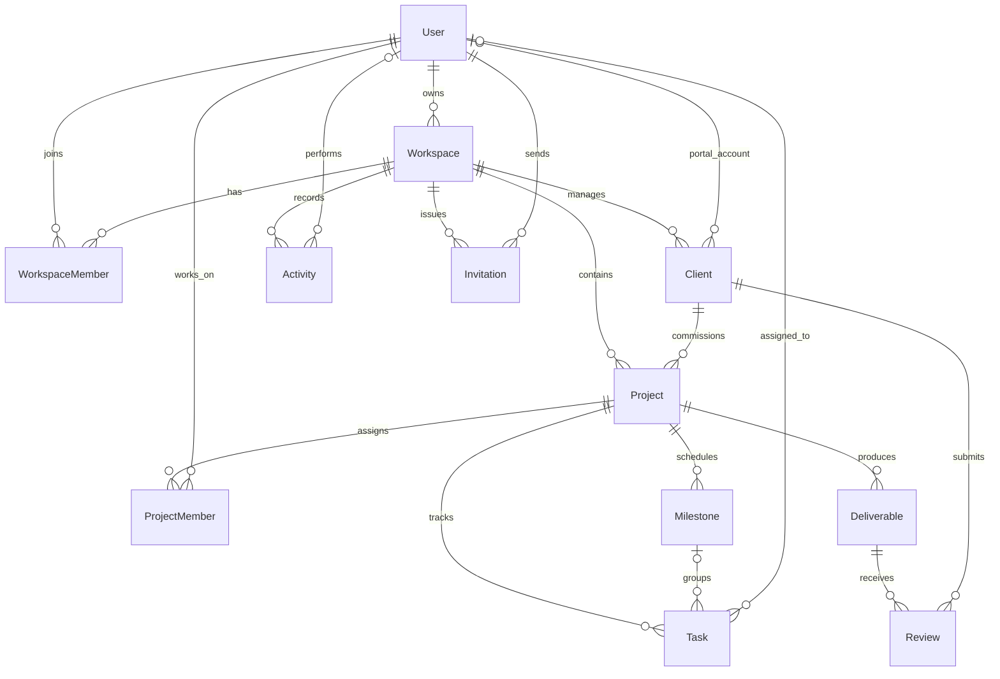

# ClientFlow database design

## Entity relationship diagram

## Model responsibilities

- **User** — authentication identity and password hash. Email is globally unique.
- **Workspace** — tenant boundary and owning account.
- **WorkspaceMember** — a user's membership and OWNER/ADMIN/MEMBER role in a workspace.
- **Client** — a workspace-owned customer profile, optionally linked to a login account for the client portal.
- **Project** — work for one client in one workspace, with lifecycle status and dates.
- **ProjectMember** — team members assigned to a project.
- **Milestone** — ordered project checkpoint with optional due/completion dates.
- **Task** — project work item, optional milestone and assignee, and explicit client visibility.
- **Deliverable** — versioned project output, review status, private object key, and optimistic revision counter.
- **Review** — a client's approval or change request with optional feedback.
- **Activity** — workspace audit event with actor, entity reference, timestamp, and JSON metadata.
- **Invitation** — hashed invitation token, target email, role, expiry, and acceptance/revocation state.

## Constraint and delete policy rationale

1. **Tenant-scoped composite foreign keys:** project-to-client, project members, milestones, tasks, deliverables, and reviews carry `workspaceId`. Composite references include that tenant key so a child row cannot point at a parent in another workspace. Application authorization must still scope every read and mutation.
2. **Unique membership:** `WorkspaceMember(workspaceId, userId)` prevents duplicate membership and supports role lookups. `ProjectMember(projectId, userId)` prevents duplicate project assignments.
3. **Client identity:** `Client(workspaceId, email)` is unique so one workspace cannot accidentally create duplicate client records for the same email, while separate workspaces may have the same customer.
4. **Deliverable versioning:** `Deliverable(projectId, name, version)` is unique. `version` identifies immutable client-review revisions; `revision` is a separate compare-and-swap counter for concurrent edits/status transitions.
5. **Invitation safety:** invitation token hashes are unique; workspace/email is unique to avoid multiple active invite records for one address. Store only a hash, never the raw invitation token.
6. **Audit indexes:** workspace/time and workspace/entity indexes support activity timelines and entity history without scanning all tenant activity.
7. **Query indexes:** compound indexes start with `workspaceId` for common tenant-scoped project, task, milestone, deliverable, client, and invitation queries.
8. **Cascade only for owned children:** deleting a workspace or project removes its dependent membership/work items. Client deletion is restricted while projects/reviews refer to it. User deletion is restricted for workspace ownership/invitation sender records, while optional actor/assignee/client-account references are set null to preserve business records.
9. **Optional relationships:** nullable assignee, milestone, portal account, actor, and dates allow work to exist before assignment or portal activation.
10. **Review integrity:** review rows reference both a deliverable and a client in the same workspace. Server-side review services must additionally verify that the client owns the deliverable's project before accepting a decision.
11. **Activity entity references:** entityType/entityId is intentionally polymorphic, so it cannot use a conventional FK. The workspace FK plus service-level authorization preserves tenant boundaries.
12. **RateLimitBucket:** an additional operational table supports database-backed rate limiting for login and invitations; it is not a customer-domain entity.

## Local demo accounts

After seeding, the local-only demo accounts are:

- `owner@clientflow.local` — OWNER
- `admin@clientflow.local` — ADMIN
- `member@clientflow.local` — MEMBER
- `client@clientflow.local` — linked client portal account

Set `SEED_DEMO_PASSWORD` before running the seed to override the local-only demo password. Never use demo credentials in production.
